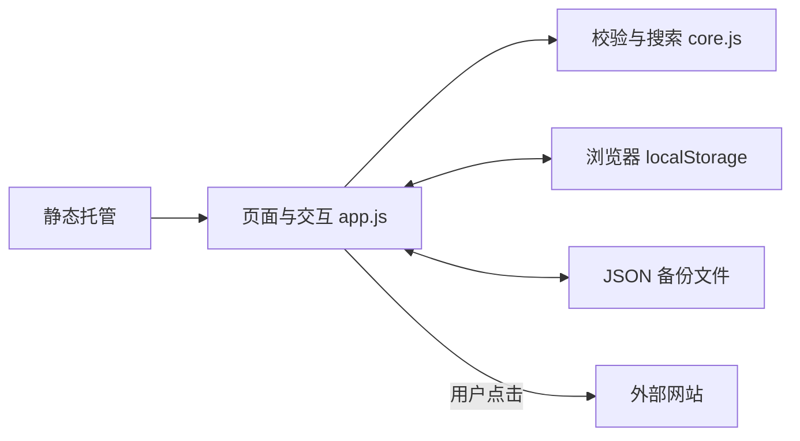

# 需求分析与架构设计

## 目标与用户路径

面向单个用户的日常网页入口：打开导航站 → 搜索或选择分类 → 跳转网站。管理路径是新增 / 编辑 / 删除收藏，使用常用收藏缩短重复查找过程。

1.2.0 面向力学研究生增加独立资源目录。`catalog.js` 负责编辑维护的精选入口，`app.js` 可以切换目录与个人收藏视图。目录不写入 localStorage；只有用户主动收藏时才经去重合并、校验和持久化。目录更新不会修改用户已经编辑或删除的个人收藏。

1.3.0 在 `journals.js` 中维护期刊基础目录，提供不修改输入的分区导入与筛选函数。可选 `journal` 元数据包含主办地区、方向及独立 cas/jcr 对象。每套分区必须同时给出区域、版本年份、学科和来源，缺失则保持 null，不从名称、影响因子或另一体系猜测。

用户导入分区表独立存于 `linknest.journal-rankings.v1`，加载失败不影响个人收藏。导入先完整校验，再存储并替换内存目录，不修改历史收藏副本。保存期刊时拷贝当前元数据；个人备份保留此快照，不包含整个分区覆盖表。

第一版优先让用户立即可用、轻松维护、可以自主备份。无需注册账号。导航列表从用户自己的浏览器加载，仓库只保存程序和公开的示例数据。

## 范围与验收标准

| 能力 | 验收标准 |
| --- | --- |
| 分类与搜索 | 切换分类立即过滤；多个关键词匹配名称、描述、地址、分类；无结果有引导 |
| 收藏管理 | 新增、编辑、删除后立即更新；刷新保留；重复规范化地址有提示 |
| 常用收藏 | 可加入、取消并单独筛选 |
| 主题与适配 | 桌面侧栏、手机横向分类；深浅主题；内容无横向溢出 |
| 备份 | 导出后可以重新导入；空备份合法；导入前完整校验；覆盖前确认 |
| 异常处理 | URL、损坏备份、容量异常不能静默破坏现有收藏 |

## 架构选择

采用无构建步骤的 HTML + CSS + 原生 JavaScript ES Modules。个人导航的状态和交互规模较小，不需要框架、服务端渲染或数据库。零运行时依赖减少安装、升级和供应链维护成本。

纯函数的数据层可以独立测试；交互层负责 DOM、事件和存储。所有数据先校验后写入，写入成功才更新内存状态。HTML 不拼接用户输入，通过 `textContent` 创建节点。链接只允许 HTTP / HTTPS，不允许包含用户名密码，外链使用 `noopener noreferrer`。

CSS 使用自定义属性管理主题，在 620 / 800 / 1150 / 1450 像素断点调整布局。无需远程字体。预置网站图标包含在本地 `icons.js` 中，按 hostname 匹配；目录更新自动作用于已有收藏，无需修改收藏数据。自定义未知域名尝试该网站原站 `/favicon.ico`，URL 不含收藏路径、查询参数或片段，图片不发送 referrer；加载失败保留通用备用标识。图标来源见 `docs/icon-sources.json`。

## 数据模型

收藏字段：`id`、`title`、`url`、`description`、`category`、`pinned`。分类从预置分类与收藏数据合并推导，新增时可输入新分类。没有独立分类表；空的自定义分类自动消失。分类名是文本，数据对象不根据用户输入动态设置属性。

可选字段 `subcategory` 和 `tags` 用于 AI 子分类和跨学科关键词。子分类最多 30 字；标签最多 12 个，每个最多 30 字。备份保持 `version: 1`，缺省字段不写入，旧备份读写结果保持兼容。搜索将这些字段纳入匹配，同时可约束主分类与子分类。此前版本的程序可能丢弃这些可选元数据，建议使用新版本恢复备份。

备份包含 `version: 1`、`exportedAt` 和 `bookmarks`。恢复时限制文件大小、收藏数量和字段长度，检查 ID 唯一性。保存键为 `linknest.data.v1`。未来升级应增加版本迁移函数，不直接改变旧版本含义。

1.1.0 增加导入预览，用户明确选择合并或替换。合并以规范化 URL 为键，保留现有条目；查询参数和片段仍参与地址比较。冲突 ID 重分配为未使用标识，输出与输入使用相同的数量及 UTF-8 字节限制。纯函数不修改输入数组，验证成功后才交给交互层保存。

多个标签页通过浏览器 `storage` 事件同步；为避免把旧表单覆盖到新数据，同步时关闭正在编辑的弹窗。本地存储是整份快照，极短时间内并发操作采用最后写入者优先，不提供事务式跨设备编辑。

同步时也取消导入预览，并在确认操作时检查预览引用是否过期。当前读不到合法本地数据时禁止合并，只能由用户明确选择有效备份进行替换恢复。

## 发布与运维

代码目标仓库为 GitHub 的 `CX330FGT/-linknest-`，拥有者已将仓库创建为公开。`dist/` 可以直接部署到静态托管。自动测试在提交或拉取请求时运行。GitHub Pages 部署仅手动触发。Pages 工作流先测试，再上传静态资源，并使用官方部署动作。

不需要运行时密钥、服务器费用配置或数据库迁移。不采集访问统计，不上传用户收藏。云同步、账号体系、团队共享、书签 HTML 导入属于后续版本；引入云同步时应先设计身份、权限、冲突合并和数据导出策略。

## 已知边界

本地保存不等于加密存储，同一浏览器来源下运行的程序可以访问这些数据。不同域名或端口不共享收藏。浏览器清理数据或隐私模式结束可能导致收藏丢失，备份是当前恢复机制。

示例外部网站不受本项目控制，访问速度和可用性因网络环境而异。本地搜索仅查询收藏，不调用互联网搜索引擎。当前不支持拖拽排序或收藏层级文件夹。
